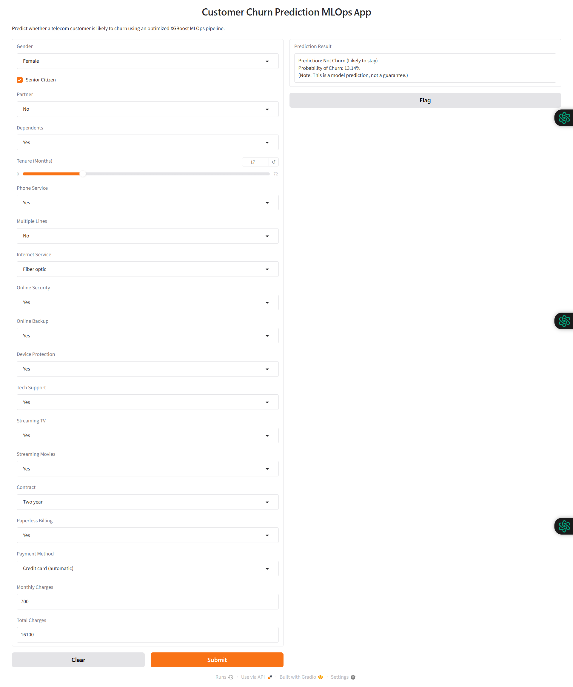

# Customer Churn Prediction — End-to-End MLOps

An end-to-end Machine Learning and MLOps project that predicts customer churn in the telecommunications industry. The project covers data validation, preprocessing, feature engineering, model training, hyperparameter optimization, experiment tracking, model evaluation, automated testing, Docker containerization, and CI/CD automation.

The application provides an interactive Gradio interface for generating customer churn predictions.

**Repository:** [GitHub](https://github.com/CodeSterAbhi/Customer_Churn_Prediction)  
**Docker Image:** [Docker Hub](https://hub.docker.com/r/codesterabhi/customer-churn-prediction)

---

## Table of Contents

- [Project Overview](#project-overview)
- [Business Problem](#business-problem)
- [Application Preview](#application-preview)
- [Key Features](#key-features)
- [Dataset](#dataset)
- [Project Architecture](#project-architecture)
- [Machine Learning Methodology](#machine-learning-methodology)
- [Technology Stack](#technology-stack)
- [Getting Started](#getting-started)
  - [Prerequisites](#prerequisites)
  - [Clone the Repository](#clone-the-repository)
  - [Install Dependencies](#install-dependencies)
- [Run the Training Pipeline](#run-the-training-pipeline)
- [MLflow Experiment Tracking](#mlflow-experiment-tracking)
- [Run the Web Application](#run-the-web-application)
- [Run with Docker Hub Image](#run-with-docker-hub-image)
- [Testing](#testing)
- [CI/CD Workflow](#cicd-workflow)
- [Future Improvements](#future-improvements)
- [Author](#author)

---

## Project Overview

Customer churn prediction is a supervised machine learning problem in which historical customer data is used to identify customers who are likely to discontinue a service.

This project implements a modular and reproducible ML pipeline, moving beyond a standalone notebook-based model towards a structured MLOps workflow.

The system includes:

- Data validation and preprocessing.
- Feature engineering and transformation.
- Machine learning model training and comparison.
- Optuna-based hyperparameter optimization.
- MLflow experiment tracking.
- Model evaluation and classification threshold optimization.
- Model artifact management.
- Automated unit testing with Pytest.
- Docker-based application deployment.
- GitHub Actions CI/CD automation.

The trained model is integrated into an interactive Gradio application, allowing users to submit customer information and obtain churn predictions.

## Business Problem

Customer churn directly affects revenue, customer lifetime value, and business growth, particularly in subscription-based industries such as telecommunications.

Identifying customers with a high probability of leaving allows businesses to:

- Identify customers who may discontinue their subscriptions.
- Prioritize customer retention campaigns.
- Understand patterns associated with customer attrition.
- Support data-driven customer retention strategies.

**Objective:** Develop a machine learning system that can identify potential customer churn using historical customer information.

## Application Preview

### Customer Churn Prediction Interface




## Key Features

| Component | Implementation |
|---|---|
| Data Validation | Input data quality and schema checks |
| Data Preprocessing | Cleaning, encoding and transformation |
| Feature Engineering | Preparation of model-ready features |
| Model Training | Structured model training and comparison |
| Hyperparameter Optimization | Optuna |
| Experiment Tracking | MLflow |
| Model Evaluation | Classification metrics and threshold optimization |
| Model Persistence | Joblib-based model artifacts |
| Web Interface | Gradio |
| API Framework | FastAPI |
| Testing | Pytest |
| Containerization | Docker |
| CI/CD | GitHub Actions |

## Dataset

**Dataset:** Telco Customer Churn

- Records: 7,043 customers
- Features: 21 columns
- Target variable: `Churn`
- Prediction classes: `Yes` and `No`

The dataset contains customer demographics, subscription details, service usage, billing information, and churn status.

**Dataset acquisition:**

Download the Telco Customer Churn dataset from Kaggle and place the CSV file at:

`data/raw/Telco-Customer-Churn.csv`

The raw dataset is not included in this repository.

## Project Architecture

The project follows a modular pipeline architecture, separating data processing, model development, evaluation, tracking, and prediction.

```text
Raw Dataset
     |
     v
Data Validation
     |
     v
Data Preprocessing
     |
     v
Feature Engineering
     |
     v
Model Training
     |
     v
Hyperparameter Optimization
     |
     v
Model Evaluation
     |
     v
MLflow Experiment Tracking
     |
     v
Model Artifact
     |
     v
Prediction Application
     |
     v
Gradio Web Interface
```

### Repository Structure

```text
Customer_Churn_Prediction/
│
├── .github/
│   └── workflows/
│       └── ci.yml
│
├── artifacts/
│   ├── best_churn_pipeline.joblib
│   └── model_metadata.json
│
├── configs/
│   └── config.yaml
│
├── data/
│   ├── raw/
│   └── processed/
│
├── notebooks/
│   └── churnAnalysis.ipynb
│
├── src/
│   └── churn_pipeline/
│       ├── __init__.py
│       ├── config.py
│       ├── data_validation.py
│       ├── data_preprocessing.py
│       ├── features.py
│       ├── train.py
│       ├── tune.py
│       ├── evaluate.py
│       ├── predict.py
│       └── tracking.py
│
├── tests/
│   ├── test_data_validation.py
│   ├── test_preprocessing.py
│   ├── test_training.py
│   └── test_prediction.py
│
├── app.py
├── run_pipeline.py
├── requirements.txt
├── pyproject.toml
├── Dockerfile
├── .dockerignore
├── .gitignore
├── churn-app-demo.png
├── mlflow-tracking.png
└── README.md
```

## Machine Learning Methodology

### 1. Data Validation

The input dataset is checked for data quality and structural consistency before further processing.

### 2. Data Preprocessing

The preprocessing workflow handles data cleaning, missing values, categorical encoding, and numerical feature transformations.

### 3. Feature Engineering

Customer attributes are transformed into model-ready features through a structured preprocessing pipeline.

### 4. Model Training and Optimization

Machine learning models are trained and evaluated using a structured workflow. Optuna is used for hyperparameter optimization.

### 5. Model Evaluation

Model performance is evaluated using classification metrics.

The classification threshold is optimized using validation data to improve F1-score rather than relying exclusively on the default 0.5 threshold.

### 6. Model Persistence

The trained pipeline and associated metadata are saved as artifacts:

- `best_churn_pipeline.joblib`
- `model_metadata.json`

The saved pipeline is used by the prediction application.

### Data Leakage Prevention

- Preprocessing transformations are fitted on training data.
- Validation and test data are not used to fit preprocessing transformations.
- Hyperparameter optimization is performed using validation or cross-validation data.
- The test set is reserved for final model evaluation.
- Classification threshold optimization uses validation data.

## Technology Stack

| Category | Technologies |
|---|---|
| Programming Language | Python |
| Data Manipulation | Pandas, NumPy |
| Machine Learning | Scikit-learn, LightGBM / configured estimators |
| Hyperparameter Optimization | Optuna |
| Experiment Tracking | MLflow |
| Data Validation | Great Expectations |
| Backend / API | FastAPI |
| User Interface | Gradio |
| Model Serialization | Joblib |
| Testing | Pytest |
| Containerization | Docker |
| CI/CD | GitHub Actions |
| Version Control | Git, GitHub |

## Getting Started

### Prerequisites

Make sure the following tools are installed:

- Python 3.10
- Git
- pip
- Docker (optional, for containerized execution)

### Clone the Repository

```bash
git clone https://github.com/CodeSterAbhi/Customer_Churn_Prediction.git

cd Customer_Churn_Prediction
```

### Install Dependencies

**Windows PowerShell:**

```powershell
# Create a virtual environment
python -m venv .venv

# Activate the environment
.\.venv\Scripts\Activate.ps1

# Upgrade pip
python -m pip install --upgrade pip

# Install dependencies
pip install -r requirements.txt

# Install the project package
pip install -e .
```

Before running the full training pipeline, download the dataset and place it in the required `data/raw/` directory.

## Run the Training Pipeline

Execute the complete training and evaluation workflow:

```bash
python run_pipeline.py
```

The pipeline executes the configured data validation, preprocessing, feature engineering, training, optimization, evaluation, and tracking stages.

## MLflow Experiment Tracking

To launch the MLflow tracking interface:

```bash
mlflow ui
```

Open the following address in your browser:

`http://localhost:5000`

MLflow provides an interface for inspecting experiment runs, parameters, metrics, and recorded model information.

## Run the Web Application

After installing dependencies and ensuring the trained model artifacts are available in the `artifacts/` directory, execute:

```bash
python app.py
```

Open the local URL displayed in the terminal to access the Gradio application.

## Run with Docker Hub Image

The application is also available as a pre-built Docker image on Docker Hub.

**Docker Hub Repository:**  
https://hub.docker.com/r/codesterabhi/customer-churn-prediction

### 1. Pull the Docker Image

```bash
docker pull codesterabhi/customer-churn-prediction:1.0
```

### 2. Run the Container

```bash
docker run --rm -p 7860:7860 codesterabhi/customer-churn-prediction:1.0
```

### 3. Access the Application

Open:

`http://localhost:7860`

The Gradio application should now be accessible through your local browser.

**Note:** The Docker image includes the trained model artifacts required for inference. You do not need to download the dataset or execute the training pipeline just to run the prediction application.

To use the automatically updated image published by GitHub Actions, pull the `latest` tag instead:

```bash
docker pull codesterabhi/customer-churn-prediction:latest
```

```bash
docker run --rm -p 7860:7860 codesterabhi/customer-churn-prediction:latest
```

## Testing

Unit tests are implemented using Pytest.

Run the test suite:

```bash
pytest
```

The tests cover the project's data validation, preprocessing, training, and prediction components.

## CI/CD Workflow

GitHub Actions automates the testing and Docker image publishing workflow.

### Workflow

```text
GitHub Push / Pull Request
          |
          v
    Checkout Code
          |
          v
    Setup Python 3.10
          |
          v
    Install Dependencies
          |
          v
      Run Pytest
          |
          v
    Build Docker Image
          |
          v
    Publish to Docker Hub
```

The workflow:

- Runs automated tests on pushes and pull requests targeting `main` or `master`.
- Builds the Docker image as part of the workflow.
- Publishes Docker images to Docker Hub on successful pushes.
- Generates `latest` and commit-specific image tags.

Docker Hub authentication is managed through GitHub repository secrets.

## Future Improvements

- Deploy the prediction application on a managed cloud platform.
- Introduce model performance monitoring and drift detection.
- Implement automated model retraining.
- Add production-grade logging and observability.
- Integrate model versioning and approval workflows.
- Expand automated integration and end-to-end testing.

## Author

**Abhijit Sharma**

B.Tech Computer Science and Engineering Student  
Interested in Machine Learning, Data Science, and MLOps.

- GitHub: [CodeSterAbhi](https://github.com/CodeSterAbhi)
- Project Repository: [Customer Churn Prediction](https://github.com/CodeSterAbhi/Customer_Churn_Prediction)
- Docker Hub: [customer-churn-prediction](https://hub.docker.com/r/codesterabhi/customer-churn-prediction)

---

*If you find this project useful, consider giving the repository a star.*
